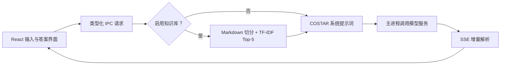

# 数学题解答助手（知识库版）

一个融合多模态大模型与本地 RAG 知识库的 Electron 桌面应用。它以 `math-solver` 的桌面交互和多模型适配为基础，将 `math-solver-rag` 的知识文档、COSTAR 提示词与 TF-IDF 检索移植为纯 TypeScript 实现，不需要 Python、LangChain、Gradio 或向量数据库。

## 主要功能

- 文字、图片、LaTeX 三种题目输入
- 中文逐步推导、答案验证与易错点提示
- Markdown 与 KaTeX 公式渲染
- DeepSeek、OpenAI、通义千问、GLM、Kimi、Gemini、Grok、Mistral、Claude
- OpenAI-compatible、Gemini、Claude 三类流式协议适配
- 本地字符 n-gram TF-IDF 检索，展示来源、片段和相似度
- 可持久化的知识库开关与温度设置
- 停止生成、重新生成、复制、清空和 Markdown 导出
- 图片压缩、视觉模型能力检查，以及图片题检索关键词

## 工作方式



知识库文档启动后首次使用时在内存中建立索引：

1. 递归读取 `resources/knowledge/**/*.md`。
2. 按约 500 字符切分，保留 50 字符重叠。
3. 构建 1–3 字符 n-gram TF-IDF 向量。
4. 对本轮问题做余弦相似度排序并取前 5 条。
5. 将命中片段作为有边界标记的参考资料加入系统提示词。

图片本身不能直接用于词法检索。图片题未填写“题目关键词或补充条件”时，应用会明确跳过 RAG，先交给视觉模型识别。

## 开发环境

- Node.js 20 或更高版本
- npm 10 或更高版本
- Windows 10/11（当前打包目标为 NSIS）

```powershell
npm ci
npm run dev
```

首次运行时打开设置，选择服务商与模型并输入对应 API Key。

## 验证与构建

```powershell
# 单元测试 + 两套严格 TypeScript 检查
npm test

# 只生成 Electron/Vite 生产资源
npm run build:app

# 测试后生成 Windows unpacked 应用目录
npm run build

# 测试后生成 NSIS 安装器
npm run build:installer
```

单元测试覆盖 RAG 切分与检索、三类 Prompt、SSE 分片/尾缓冲、图片附件归属，以及 OpenAI-compatible、Gemini、Claude 请求体。

## 项目结构

```text
resources/knowledge/           内置数学知识 Markdown
src/shared/contracts.ts        Renderer / Preload / Main 共享协议
src/shared/providerCatalog.ts  可公开给界面的模型元数据
src/shared/providers.ts        主进程模型请求适配器
src/shared/prompts.ts          COSTAR、负向约束和 RAG 上下文
src/main/ragCore.ts            纯 TypeScript TF-IDF 核心
src/main/rag.ts                知识文件加载与索引生命周期
src/main/messageMapper.ts      多模态消息转换
src/main/sse.ts                增量 SSE 解析
src/main/settings.ts           版本化设置与 API Key 存储
src/main/ipc.ts                IPC 校验、RAG 编排和流式调用
src/preload/index.ts           最小化 contextBridge
src/renderer/                  React、Zustand、KaTeX 界面
tests/                         无真实 API 的确定性单元测试
docs/                          架构、探索报告和来源说明
```

## 隐私与安全

- API 请求只由 Electron 主进程发出，Renderer 不再取得或转发 API Key。
- Windows 上优先使用 Electron `safeStorage`（DPAPI）加密 API Key；系统加密不可用时才回退为当前用户目录中的本地设置文件。
- 切换服务商会清除旧 Key，避免把一个厂商的凭据误发给另一个厂商。
- Provider、模型、消息角色、消息数量、文本长度、图片格式和大小均在主进程运行时校验。
- BrowserWindow 开启沙箱、上下文隔离和导航限制；LaTeX 普通文本会先转义。
- 知识检索完全离线，但最终题目、历史消息和命中片段会发送给所选模型服务商。

## 已知边界

- 当前 RAG 是小型词法检索，不是语义 embedding；追问“那第二问呢”这类缺少上下文关键词的查询可能命中较差。
- 内置资料应继续做数学正确性审校，模型答案也必须由使用者复核。
- 模型名称和第三方 API 可能变化，若服务商下线模型，需要更新注册表。
- 聊天记录只保存在内存中；导出后可用于复习，但应用重启不会恢复对话。
- 当前没有自动调用真实模型的 CI 测试，避免消耗配额和暴露密钥。

## 来源与许可

融合基线：

- [`eiei-ee/math-solver`](https://github.com/eiei-ee/math-solver) @ `1484144bbaedaaf2418874c32792f3b728158b63`
- [`eiei-ee/math-solver-rag`](https://github.com/eiei-ee/math-solver-rag) @ `b143fa4e5db9d2670bdc3f0f63b011920c8741f8`

详细迁移关系见 [`docs/provenance.md`](docs/provenance.md)，完整代码探索见 [`docs/REPOSITORY_EXPLORATION.md`](docs/REPOSITORY_EXPLORATION.md)。两个源仓在上述提交均未包含开源许可证；本仓也暂不附加许可证。公开发布前应由权利人明确选择许可证并确认知识文档的再分发权。
